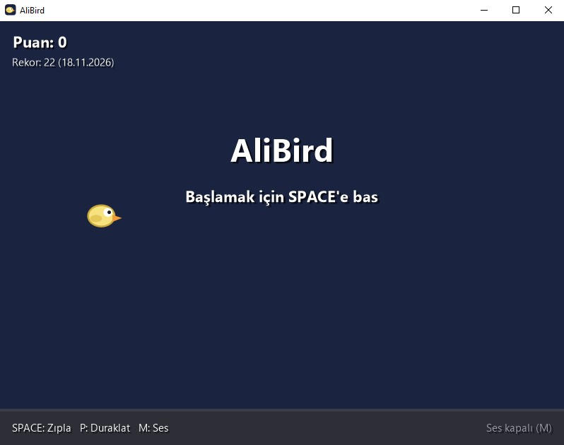
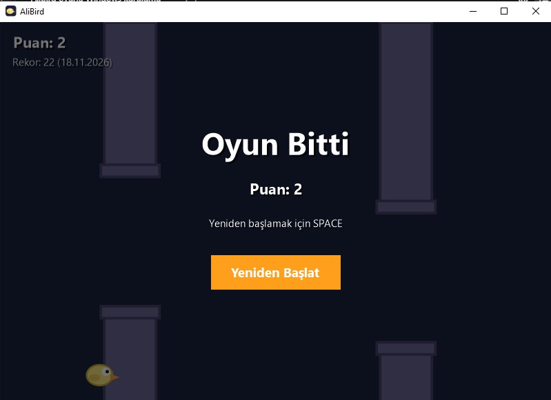

# AliBird

[](https://github.com/Ali-Istanbullu/YMH219-FlappyBird/actions/workflows/ci.yml)

<p align="center"></p>

Flappy Bird tarzında, C# ve Windows Forms ile yazılmış 2B bir oyun.
**YMH219 Nesne Tabanlı Programlama** — 1. uygulama ödevi.

**Ali İstanbullu — 250542019**

## Ekran Görüntüleri

| Başlangıç | Duraklatıldı | Oyun Bitti |
|---|---|---|
|  |  |  |

## Özellikler

- `Space` başla / zıpla / yeniden başla, `P` duraklat / devam, `M` sesi aç / kapat.
- Borular sağdan sola akar, boşluk yüksekliği rastgeledir. Hız 6'dan 13'e yavaşça artar (Chrome Dino değerleri).
- Puan ve rekor (tarihiyle) ekranda; rekor SQLite'ta saklanır, geçilince **YENİ REKOR!** yazar.
- Sesler kodla (sinüs dalgası) üretilir. Ses cihazı yoksa oyun sessiz devam eder, sağ altta `Ses yok` yazar.
- Pencere arkada kalınca ya da küçültülünce oyun duraklar. Pencere oranı korunarak ölçeklenir.
- Çizim tamamen GDI+ ile yapılır, resim dosyası yoktur. Oyun ikinci kez açılamaz.

## Çalıştırma

**Kurulum:** [Releases](https://github.com/Ali-Istanbullu/YMH219-FlappyBird/releases) → `AliBird-Kurulum-1.0.0.exe`.
.NET 10 Desktop Runtime yoksa kurulum onu indirip kurar.

**Kaynak koddan** (Windows x64, .NET SDK 10.0.401):

```
dotnet build
dotnet test
dotnet run --project src/AliBird.WinForms
```

## Teknolojiler

C# / .NET 10, Windows Forms, GDI+, Microsoft.Extensions.DependencyInjection 11.0.0, Microsoft.Data.Sqlite 11.0.0,
Serilog 4.4.0 (+ Sinks.File 7.0.0), NAudio.WinMM 3.3.0, MSTest 4.0.2, Inno Setup, GitHub Actions.

## Proje Yapısı

```
src/AliBird.Core             Oyun mantığı ve presenter (Windows'a bağlı değil)
src/AliBird.Infrastructure   SQLite, Serilog, NAudio, dosya yolları
src/AliBird.WinForms         Pencere, GDI+ çizimi, Program.cs
src/AliBird.IconGenerator    İkonu üreten araç
tests/...Core.Tests, ...Infrastructure.Tests   Birim testleri (129)
tests/...SmokeTests          Oyun ayağa kalkıyor mu, uçtan uca akış (3)
tests/...PerformanceTests    Oyun mantığı ve çizim 16 ms kare bütçesinde mi (3)
installer/AliBird.iss        Inno Setup betiği
.github/workflows            CI (her push'ta derle + test), Release (v* etiketiyle kurulum exe'si)
```

Rekor `%LocalAppData%\AliBird\data\alibird.db`, loglar `%LocalAppData%\AliBird\logs` içindedir.

## Kod Sözlüğü

| Kod | Anlamı |
|---|---|
| `Kus`, `Engel`, `EngelAlani` | Kuş, boru çifti, boruların hepsi |
| `CarpismaDenetcisi`, `HizDenetcisi`, `PuanTablosu` | Çarpışma, hız artışı, puan ve rekor |
| `OyunMotoru` | Bir oyunun kare kare işlenmesi |
| `OyunYoneticisi` | Presenter: tuşlar, oyun döngüsü, ekran |
| `RekorYoneticisi`, `SqlitePuanDeposu` | Rekoru okur / kaydeder |
| `SesYoneticisi`, `SesUreteci` | Ses kararları, sesleri kodla üretir |
| `KareSuresiOlcer`, `KareCarpaniHesaplayici` | Delta time: geçen süreyi "kaç kare" olduğuna çevirir |
| `AnaForm`, `OyunCizici` | Pencere, çizim |

## Sınırlamalar

- Sadece Windows x64.
- WinForms Timer ölçümde ~28 ms'de bir çalıştı (~35 FPS). Oyun hızı delta time ile doğrudur, ama hareket 60 FPS kadar akıcı değildir.
- Sadece en yüksek puan saklanır; skor listesi ve zorluk seviyesi yoktur.
- Kurulum dosyası imzalı değil; SmartScreen uyarısında "Ek bilgi → Yine de çalıştır".

## Lisans

[MIT](LICENSE) © 2026 Ali İstanbullu
