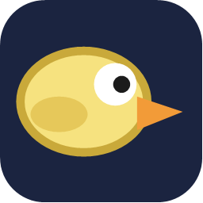
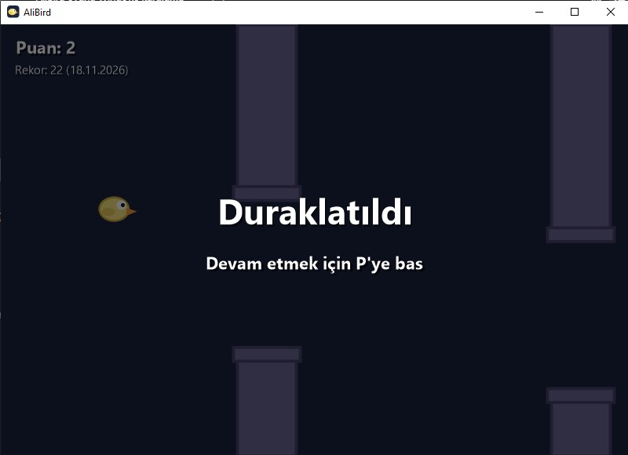

# AliBird

<p align="center"></p>

Flappy Bird tarzında, C# ve Windows Forms ile yazılmış 2B bir oyun.
**YMH219 Nesne Tabanlı Programlama** dersinin 1. uygulama ödevidir.

| | |
|---|---|
| **Öğrenci** | Ali İstanbullu |
| **Öğrenci No** | 250542019 |
| **Ders** | YMH219 Nesne Tabanlı Programlama |
| **Sürüm** | 1.0.0 |

## Amaç

Klavyeyle yönetilen bir kuşu, sağdan sola akan boruların arasındaki boşluklardan geçirmek.
Kuş yer çekimiyle düşer, **Space** ile zıplar. Boruya ya da zemine çarpınca oyun biter.
Geçilen her boru 1 puandır. En yüksek puan, tarihiyle birlikte saklanır.

Ödevin teknik amacı: sınıflar ve nesneler, kapsülleme, arayüzler, olay (event) kullanımı,
Timer ile oyun döngüsü, çarpışma kontrolü ve hata yönetimi.

## Ekran Görüntüleri

| Başlangıç | Duraklatıldı | Oyun Bitti |
|---|---|---|
|  |  |  |

## Özellikler

- **Kontroller:** `Space` başla / zıpla / yeniden başla, `P` duraklat / devam, `M` sesi aç / kapat. Tuşlar ekranın sol altında her zaman yazar.
- **Engeller:** 3 boru sürekli sağdan sola akar. Ekrandan çıkan boru sağa taşınır, boşluğu rastgele bir yüksekliğe gelir.
- **Artan hız:** Chrome'un Dino oyunundaki değerler kullanılır. Hız 6'dan başlar, yavaş yavaş 13'e kadar çıkar.
- **Puan ve rekor:** Puan ve rekor (tarihiyle) sol üstte görünür. Rekor geçilince **YENİ REKOR!** yazısı çıkar. Rekor SQLite'ta saklanır.
- **Sesler:** Zıplama, puan, çarpma ve oyun bitti sesleri. Hepsi kodla (sinüs dalgası) üretilir, ses dosyası yoktur. Ses cihazı yoksa oyun yine oynanır, sağ altta `Ses yok` yazar.
- **Oyun Bitti ekranı:** Puan gösterilir. `Space` ya da **Yeniden Başlat** butonu ile tekrar başlanır.
- **Otomatik duraklatma:** Pencere başka bir pencerenin arkasında kalınca ya da küçültülünce oyun duraklar.
- **Ölçeklenen pencere:** Oyun 640×480'lik bir alanda çizilir ve pencere boyutuna oranı korunarak ölçeklenir. Zorluk pencere boyutundan etkilenmez.
- **Tek kopya:** Oyun ikinci kez açılırsa "AliBird zaten açık" mesajı çıkar.
- **Çökmez:** Önemli her işlem `try/catch` ile korunur. Kullanıcıyı ilgilendiren hatalar ekranda gösterilir, hepsi loga yazılır.
- **Çizim:** Tamamen GDI+ ile yapılır, hiçbir resim dosyası kullanılmaz. İkon da oyundaki kuşu çizen kodla üretilir.

## Kurulum ve Çalıştırma

### Kurulum dosyasıyla (oyuncu için)

1. [Releases](https://github.com/Ali-Istanbullu/YMH219-FlappyBird/releases) sayfasından `AliBird-Kurulum-1.0.0.exe` dosyasını indirin.
2. Çalıştırın. Bilgisayarda **.NET 10 Desktop Runtime** yoksa kurulum onu Microsoft'tan indirip kendisi kurar (internet gerekir).
3. Masaüstü ve Başlat menüsü kısayolları isteğe bağlıdır.

Kaldırınca program klasörü tamamen silinir. Rekor ve loglar (`%LocalAppData%\AliBird`) bilerek silinmez, böylece yeniden kurunca rekor geri gelir.

### Kaynak koddan (geliştirici için)

Gerekenler: Windows x64, [.NET SDK 10.0.401](https://dotnet.microsoft.com/download/dotnet/10.0) (`global.json` ile sabitlenmiştir), isteğe bağlı olarak Visual Studio.

```
git clone https://github.com/Ali-Istanbullu/YMH219-FlappyBird.git
cd YMH219-FlappyBird
dotnet run --project src/AliBird.IconGenerator -- assets   # ikonu üretir (repoda zaten var)
dotnet build
dotnet test
dotnet run --project src/AliBird.WinForms
```

Kurulum dosyasını üretmek için ([Inno Setup 7](https://jrsoftware.org/isdl.php) gerekir):

```
dotnet publish src/AliBird.WinForms -c Release -r win-x64 --self-contained false -o publish/AliBird
ISCC.exe installer\AliBird.iss
```

Çıktı: `installer\Output\AliBird-Kurulum-1.0.0.exe`

## Kullanılan Teknolojiler

| Teknoloji | Sürüm | Ne için |
|---|---|---|
| C# / .NET | .NET 10 (SDK 10.0.401) | Dil ve platform |
| Windows Forms | .NET 10 | Pencere, klavye olayları, Timer |
| GDI+ (`System.Drawing`) | .NET 10 | Tüm çizimler |
| Microsoft.Extensions.DependencyInjection | 11.0.0 | Bağımlılık enjeksiyonu (DI) |
| Microsoft.Data.Sqlite | 11.0.0 | Rekorun saklanması |
| Serilog + Serilog.Sinks.File | 4.4.0 / 7.0.0 | Log dosyası (1 MB × 5 dosya, eskiler kendiliğinden silinir) |
| NAudio.WinMM | 3.3.0 | Seslerin çalınması |
| MSTest | 4.0.2 | Birim testleri (131 test) |
| Inno Setup | 7.1.0 | Kurulum dosyası |

## Proje Yapısı ve Mimari

```
src/
  AliBird.Core            Oyun mantığı (fizik, çarpışma, puan, presenter). Windows'a bağlı değil.
  AliBird.Infrastructure  SQLite, Serilog, NAudio, dosya yolları
  AliBird.WinForms        Pencere, GDI+ çizimi, Program.cs (DI burada kurulur)
  AliBird.IconGenerator   İkonu (PNG + ICO) üreten küçük araç
tests/
  AliBird.Core.Tests            88 test
  AliBird.Infrastructure.Tests  43 test
installer/AliBird.iss     Inno Setup betiği
docs/DECISIONS.md         Projede alınan tüm kararlar
```

- **MVP deseni:** `AnaForm` sadece çizer ve tuşları bildirir (pasif görünüm). Kararları `OyunYoneticisi` (presenter) verir.
- **SOLID:** Her sınıfın tek bir görevi vardır. Sınıflar birbirini arayüzler üzerinden kullanır.
- **Bağımlılık enjeksiyonu:** Nesneler yalnızca `Program.cs`'te birbirine bağlanır. Diğer sınıflar ihtiyaçlarını constructor'dan alır.
- **Delta time:** Hareket geçen süreye göre hesaplanır, böylece oyun her bilgisayarda aynı hızda akar.
- **Testler:** Mock kütüphanesi kullanılmaz, sahte sınıflar elle yazılmıştır.

### Dosya konumları

| Ne | Nerede |
|---|---|
| Rekor | `%LocalAppData%\AliBird\data\alibird.db` |
| Loglar | `%LocalAppData%\AliBird\logs\alibird.log` |

Veritabanı silinirse yeniden oluşturulur. Bozuksa `alibird.corrupt-*.db` adıyla kenara alınır ve yenisi açılır.

## Kod Sözlüğü

Kod Türkçe ve ASCII karakterlerle yazılmıştır (ı, ş, ğ, ü, ö, ç kullanılmaz).

| Kod | Anlamı | English |
|---|---|---|
| `Kus` | Oyuncunun yönettiği kuş | Bird |
| `Engel` | Üst ve alt borudan oluşan engel | Obstacle (pipe pair) |
| `EngelAlani` | Engellerin hepsini yönetir | Obstacle field |
| `CarpismaDenetcisi` | Çarpışma kontrolü | Collision checker |
| `HizDenetcisi` | Oyun hızının artışı | Speed controller |
| `PuanTablosu` | Puan ve rekor karşılaştırması | Scoreboard |
| `OyunMotoru` | Bir oyunun kare kare işlenmesi | Game engine |
| `OyunMotoruFabrikasi` | Her yeni oyun için yeni motor üretir | Game engine factory |
| `OyunYoneticisi` | Presenter: tuşlar, oyun döngüsü, ekran | Game manager (presenter) |
| `OyunDurumu` | Hazir / Calisiyor / Duraklatildi / OyunBitti | Game state |
| `OyunAyarlari` | Tüm sayısal değerler tek yerde | Game settings |
| `RekorYoneticisi` | Rekoru okur ve kaydeder | High score manager |
| `SesYoneticisi` | Ses açık / kapalı, sesi çalar | Sound manager |
| `SesUreteci` | Sesleri kodla üretir | Sound generator |
| `KareSuresiOlcer` | İki kare arasındaki süreyi ölçer | Frame time meter |
| `KareCarpaniHesaplayici` | Geçen süreyi "kaç kare" olduğuna çevirir | Frame multiplier (delta time) |
| `SqlitePuanDeposu` | Rekoru SQLite'ta saklar | SQLite score store |
| `SerilogGunlukcu` | Log yazar | Logger |
| `HataBildirici` | Hatayı ekrana ve / veya loga iletir | Error reporter |
| `AnaForm` | Oyun penceresi | Main form |
| `OyunCizici` | Tuvali hazırlar, katmanları çizdirir | Game renderer |
| `SahneCizici` / `BilgiCizici` / `DurumKatmaniCizici` | Sahne / yazılar / durum ekranı katmanları | Scene / HUD / overlay renderers |
| `KusCizici` | Kuşu çizer (oyun ve ikon ortak) | Bird renderer |
| `Tema` | Renkler | Theme |
| `Zipla`, `Guncelle`, `Ilerlet`, `Ciz` | Zıpla, güncelle, ilerlet, çiz | Jump, update, step, draw |

Arayüzler `I` ile başlar (`IKus`, `IPuanDeposu`, `ISesCalar` ...). Sahte test sınıfları `Sahte` ile başlar (`SahteSaat`).

## Bilinen Sınırlamalar

- **Sadece Windows x64.** Windows Forms ve NAudio WinMM Windows'a bağlıdır.
- **SmartScreen uyarısı:** Kurulum dosyası kod imzalı değildir. İlk açılışta Windows "bilinmeyen yayımcı" uyarısı verebilir. "Ek bilgi → Yine de çalıştır" ile devam edilir.
- **Görüntü yaklaşık 35 FPS:** WinForms Timer, 16 ms istense de ölçümde ortalama ~28 ms'de bir çalıştı. Oyun hızı delta time sayesinde doğrudur, ancak hareket 60 FPS kadar akıcı değildir.
- **Tek rekor:** Sadece en yüksek puan (tarihiyle) saklanır, skor listesi yoktur. Zorluk seviyesi yoktur.
- **İnternet:** Bilgisayarda .NET 10 Desktop Runtime yoksa, kurulum sırasında internet gerekir.

## Kaynaklar

- Fizik ve hız değerleri: Chrome Dino oyunu (`offline.js`: `SPEED 6`, `MAX_SPEED 13`, `ACCELERATION 0.001`, `GAMEOVER_CLEAR_TIME 750`).
- .NET 10 Desktop Runtime indirme bağlantısı: `https://aka.ms/dotnet/10.0/windowsdesktop-runtime-win-x64.exe`
- Zamanlayıcı ölçümleri ve tüm kararlar: [docs/DECISIONS.md](docs/DECISIONS.md)

## Lisans

[MIT](LICENSE) © 2026 Ali İstanbullu
